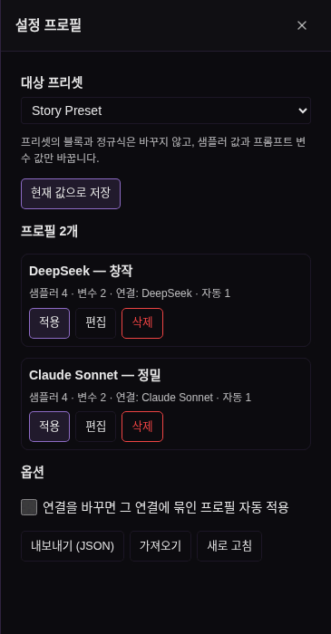
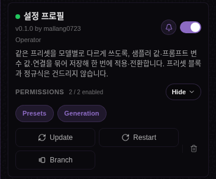
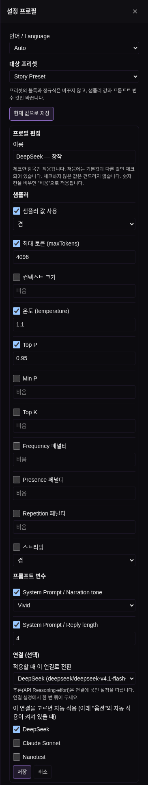
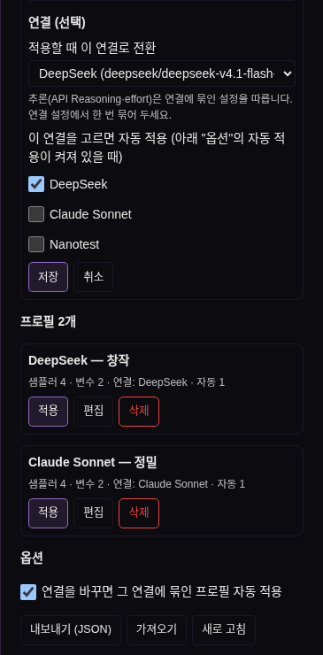

# Setting Profiles for Lumiverse · 설정 프로필

Version **0.2.0-v2** · [한국어](#한국어)

Use one [Lumiverse](https://lumiverse.chat/) preset with different models: save selected sampler settings and prompt-variable values as profiles, optionally attach a connection, and apply them together. Keep your prompt structure without duplicating presets or editing blocks and regex scripts.

One extension includes both Korean and English UI. In the Profiles Drawer tab, choose **언어 / Language → Auto / 한국어 / English**. The default is **Auto**; changes apply immediately without reloading and are saved per Lumiverse user.

**Auto follows Lumiverse's interface language (Settings → Display → Interface language)**, stored as `lumiverse-ui-language`: Korean selects Korean; every other stored language selects English. If no preference is stored (or storage is unavailable), Auto uses `navigator.language`: Korean when it starts with `ko`, otherwise English. Manual selection overrides Auto. Auto rechecks after host language changes (at 0, 150, and 500ms, stopping when the stored value changes), on storage events, and when the window gains focus or becomes visible. Existing status messages also follow language changes. Screenshots show the Korean UI; the guide lists both button labels.



## Features

- Save, edit, delete, and apply profiles per preset; only included fields change.
- Include temperature, Top P/Min P/Top K, token/context limits, penalties, sampler-enable and streaming switches, and prompt-variable values.
- Switch connections on manual apply, or auto-apply when selecting an assigned connection.
- Undo the last backed-up apply and export/import profiles as JSON.

## Requirements

- **Lumiverse 1.2.5 or later** (tested on a live 1.2.5-version server and on 1.3.0 staging).
- An existing Loom preset.
- Variables defined in that preset for variable profiles.
- An existing connection for connection features.

## Install

1. Open **Lumiverse drawer → Extensions → Add Extension**.
2. Paste this URL into **Install from Source** and install:

   ```text
   https://github.com/mallang0723/LV-SettingProfiles
   ```

3. Enable **설정 프로필** and review **Permissions**:
   - **`presets` — required:** reads presets and updates sampler/variable values.
   - **`generation` — optional:** enables connection switching and auto-apply; manual sampler/variable profiles work without it. No model calls are made.
4. Open the Drawer’s **세팅 / Settings P.** tab (full title: **설정 프로필 / Setting Profiles**).



## Usage

1. Choose **대상 프리셋** (Target preset). **(현재)** marks the active preset. Choosing a target here does not activate it.
2. Click **현재 값으로 저장** (Save from current values) and name the profile.
3. Check and edit the fields to include. **Unchecked fields stay unchanged.** Set numeric samplers and variables differing from defaults start checked; include sampler-enable and streaming switches explicitly.
4. Optionally choose **적용할 때 이 연결로 전환** (Switch to this connection on apply), then **저장** (Save). Saving alone does not apply anything.
5. Click **적용** (Apply) on the card and read the result. Matching values are left alone; a configured connection can still switch.
6. Use **되돌리기** (Undo), **편집** (Edit), or **삭제** (Delete). Deleting a profile does not revert applied settings.
7. **내보내기 (JSON)** (Export) downloads all profiles; **가져오기** (Import) adds new entries without replacing existing ones.
8. **새로 고침** (Refresh) reloads preset/connection lists. Reselect a preset to reload its values after external edits.

**Input tips:** A checked blank numeric field clears its override. With samplers enabled, cleared temperature/max tokens use **1.0 / 16384**; other cleared numbers are omitted. Zero also omits some parameters. Range variables use `[1, 5]`; multiselect variables use option IDs such as `["a", "b"]`.



## Settings

**언어 / Language** defaults to **Auto** and can be changed to **한국어** or **English** at any time. The input-bar menu entry also opens the Profiles Drawer.

**Auto-apply is off by default.** Under **옵션** (Options), enable **연결을 바꾸면 그 연결에 묶인 프로필 자동 적용**. In a profile, check connections under **이 연결을 고르면 자동 적용**, then save.

Only profiles for the **active preset** qualify. Assign one profile per preset/connection; the first stored match wins. Auto-apply runs on connection changes while Lumiverse and the extension are loaded—not on preset changes or simply enabling the option. Test by switching away and back.

**Reasoning / effort** follows Lumiverse's connection bindings; configure it in connection settings. This extension does not edit it.



## Safety and undo

- **Unchanged:** preset names, prompt text, blocks/order, regex scripts, chats, characters, personas, credentials, and built-in preset-profile bindings. Only selected settings and optional connection selection change.
- **One backup per preset:** a successful value-changing apply replaces it; matching values do not. Undo restores changed fields, overwrites any later edits to those fields, and consumes the backup. There is no redo.
- Undo also attempts to restore the previous connection when recorded. Connection-only changes create no backup, and an empty previous selection cannot be restored; handle those manually.
- JSON exports contain **profiles only**, excluding undo backups, options, presets, and connections. Use Lumiverse's preset backups for a full restore.
- Conflicting edits are retried once, then reported. **Failures can leave partial changes without a usable undo backup**; a failed connection switch does not revert settings. Reload and inspect actual values before retrying.
- Applying through an open Loom editor can save other pending edits. If the editor rejects the update, the extension tries a direct save and warns. Refresh before further editing as described below.

## FAQ / troubleshooting

1. **Applied, but samplers have no effect?** Include **샘플러 값 사용 → 켬** (Use sampler values → On), or enable it in Loom. Check that the edited preset is active. Streaming is separate and can be disabled even when samplers are off.
2. **Variables still use other values?** Built-in chat/persona/character/connection/default bindings can override preset values. Check those in Lumiverse; this extension does not edit them. A binding warning is not always available. Removed variables are skipped, but their profile values are retained.
3. **Auto-apply is disabled or does nothing?** Grant `generation`, enable the option, and save a trigger connection for the active preset. Read any explanation shown. Replace deleted connections, then switch away and back to test.
4. **Loom shows old values or `Invalid Loom blocks[…]`?** Reload before saving the variable dialog; after a direct-save warning, reload before editing samplers too. Stale editor values can overwrite applied settings. If applying is refused, select another preset in Loom or reload. Hiding its tab does not close the draft.
5. **Missing preset or failed import?** Check `presets` permission and Refresh. Only 200 presets are listed. Import accepts this extension's JSON, up to **2 MiB**, processing the first **200 entries**; invalid entries may be skipped. Preset/connection IDs must still exist—import does not recreate or remap them.

## Privacy and storage

Profiles, names, preset/connection IDs, values, timestamps, undo backups, and options are stored in **`profiles.json` in Lumiverse's per-user extension storage on the host server**. Applied values go into preset data. Exports download to your browser; imports go to your Lumiverse host.

The extension reads presets, connection details, active-preset state, and the current chat ID, not conversation history. **No external-service requests, telemetry, or model calls.** Installation/updates fetch GitHub through Lumiverse. Later generation sends the resulting prompt/settings to your configured model provider as usual. Review exported names and variable text before sharing.

## Limitations

Settings affect the preset, not individual chats. Only defined variables apply; input checks do not guarantee model/provider support. Imports work where the original preset/connection IDs exist. The editor and binding limitations also apply to undo and auto-apply.

## License and credits

[MIT](LICENSE). Copyright and attribution remain in [LICENSE](LICENSE); the author field remains in [spindle.json](spindle.json).

## Changelog

- **0.2.0-v2** — Fix live Auto language timing, refresh on focus/visibility, retranslate existing status messages, and distinguish the Drawer tab with **세팅 / Settings P.**.

- **0.2.0-v1** — One build with Korean/English UI, per-user language selection, live Auto language updates, and localized results and input-bar shortcut.

- **0.1.0** — Sampler/variable profiles, connection switching and auto-apply, one-level undo, JSON import/export, conflict retry, and open-editor handling.

---

# 한국어

버전 **0.2.0-v2**

같은 [Lumiverse](https://lumiverse.chat/) 프리셋을 여러 모델에 맞춰 사용하세요. 선택한 샘플러 설정과 프롬프트 변수 값을 프로필로 저장하고, 필요하면 연결도 지정해 한 번에 적용합니다. 프리셋을 복사하거나 블록·정규식을 수정하지 않고 프롬프트 구조를 유지할 수 있습니다.

하나의 확장에서 한국어와 영어 UI를 모두 제공합니다. 프로필 Drawer 탭의 **언어 / Language → Auto / 한국어 / English**에서 선택하세요. 기본값은 **Auto**이며, 새로 고침 없이 즉시 적용되고 Lumiverse 사용자별로 저장됩니다.

**Auto는 Lumiverse의 인터페이스 언어(설정 → 화면 표시 → 인터페이스 언어)**를 따릅니다. `lumiverse-ui-language`에 저장된 값이 한국어이면 한국어, 그 외에는 영어를 표시합니다. 저장값이 없거나 저장소를 읽을 수 없을 때만 브라우저의 `navigator.language`가 `ko`로 시작하면 한국어, 아니면 영어를 사용합니다. 수동 선택이 Auto보다 우선하며, Auto 상태에서는 호스트 언어 변경 후 0·150·500ms에 저장값을 재확인하고, 값이 바뀌면 재시도를 중단합니다. 저장소 이벤트와 창 포커스·다시 표시될 때도 반영합니다. 이미 표시된 상태 메시지도 선택 언어로 다시 번역됩니다. 스크린샷은 한국어 UI 기준입니다.


## 기능

- 프리셋마다 프로필을 저장·편집·삭제·적용하며, 포함한 항목만 바꿉니다.
- 온도, Top P/Min P/Top K, 토큰·컨텍스트 크기, 페널티, 샘플러 사용·스트리밍 스위치, 프롬프트 변수 값을 저장합니다.
- 수동 적용 시 연결을 전환하거나, 지정한 연결을 선택할 때 자동 적용합니다.
- 마지막 백업에 해당하는 적용을 되돌리고, 프로필을 JSON으로 내보내고 가져옵니다.

## 요구 사항

- **Lumiverse 1.2.5 이상** (1.2.5 버전 실서버와 1.3.0 스테이징에서 동작 확인).
- 기존 Loom 프리셋.
- 변수 프로필을 쓰려면 해당 프리셋에 정의된 변수.
- 연결 기능을 쓰려면 기존 연결.

## 설치

1. **Lumiverse 서랍 → Extensions → Add Extension**을 엽니다.
2. **Install from Source**에 아래 URL을 붙여 넣고 설치합니다.

   ```text
   https://github.com/mallang0723/LV-SettingProfiles
   ```

3. **설정 프로필**의 **Enable**을 켜고 **Permissions**를 확인합니다.
   - **`presets` — 필수:** 프리셋을 읽고 샘플러·변수 값을 갱신합니다.
   - **`generation` — 선택:** 연결 전환·자동 적용에 필요합니다. 거부해도 샘플러·변수 프로필은 수동 적용할 수 있으며, 모델을 호출하지는 않습니다.
4. 서랍의 **세팅 / Settings P.** 탭을 엽니다(전체 제목: **설정 프로필 / Setting Profiles**).


## 사용법

1. **대상 프리셋**을 고릅니다. **(현재)**는 활성 프리셋입니다. 여기서 대상을 골라도 활성화되지는 않습니다.
2. **현재 값으로 저장**을 누르고 프로필 이름을 입력합니다.
3. 포함할 항목을 체크하고 편집합니다. **체크하지 않은 항목은 그대로 둡니다.** 값이 지정된 숫자형 샘플러와 기본값과 다른 변수는 처음부터 체크되며, 샘플러 사용·스트리밍 스위치는 직접 포함해야 합니다.
4. 필요하면 **적용할 때 이 연결로 전환**을 고르고 **저장**합니다. 저장만으로 적용되지는 않습니다.
5. 카드의 **적용**을 누르고 결과를 읽습니다. 이미 같은 값은 그대로 두지만, 지정한 연결로는 전환될 수 있습니다.
6. **되돌리기**, **편집**, **삭제**로 관리합니다. 프로필을 삭제해도 적용한 설정은 되돌아가지 않습니다.
7. **내보내기 (JSON)**는 모든 프로필을 내려받고, **가져오기**는 기존 항목을 교체하지 않고 새 항목으로 추가합니다.
8. **새로 고침**은 프리셋·연결 목록을 다시 읽습니다. 외부에서 수정한 값은 해당 프리셋을 다시 선택해 불러오세요.

**입력 팁:** 체크한 숫자 칸을 비우면 값을 비웁니다. 샘플러 사용이 켜져 있으면 비운 온도·최대 토큰은 **1.0 / 16384**를 사용하고, 나머지 비운 숫자는 요청에서 생략합니다. 일부 항목은 0도 생략을 뜻합니다. 범위 변수는 `[1, 5]`, 다중 선택은 `["a", "b"]`처럼 선택지 ID로 입력합니다.


## 설정

**언어 / Language**의 기본값은 **Auto**이며, 언제든 **한국어**나 **English**로 바꿀 수 있습니다. 입력창 메뉴에서도 프로필 Drawer를 열 수 있습니다.

**자동 적용은 기본 꺼짐**입니다. **옵션**에서 **연결을 바꾸면 그 연결에 묶인 프로필 자동 적용**을 켜고, 프로필의 **이 연결을 고르면 자동 적용**에 연결을 체크해 저장하세요.

**활성 프리셋**의 프로필만 적용합니다. 여러 개가 일치하면 저장 목록의 첫 번째가 선택되므로 프리셋·연결 조합마다 하나를 지정하세요. Lumiverse와 확장이 로드된 동안 연결 변경에 반응하며, 프리셋만 바꾸거나 옵션만 켜서는 실행되지 않습니다. 다른 연결로 갔다가 돌아와 시험하세요.

**추론·effort**는 Lumiverse의 연결 바인딩을 따릅니다. 연결 설정에서 지정하세요. 이 확장이 직접 수정하지는 않습니다.


## 안전과 되돌리기

- **변경하지 않는 항목:** 프리셋 이름, 프롬프트 문구, 블록·순서, 정규식, 채팅, 캐릭터, 페르소나, 인증 정보, 기본 프리셋 프로필 바인딩. 선택한 설정과 선택적 연결 전환만 바뀝니다.
- **프리셋당 백업 1개:** 값을 바꾸는 적용이 성공하면 교체하고, 이미 같은 값이면 유지합니다. 되돌리기는 바뀐 항목만 복원하되 이후 같은 항목을 직접 고친 값도 덮어쓰며, 백업을 소모합니다. 다시 실행은 없습니다.
- 이전 연결이 기록되어 있으면 복원도 시도합니다. 연결만 바꾸면 새 백업이 생기지 않고, 이전 연결 선택이 비어 있었다면 복원하지 못하므로 직접 바꾸세요.
- JSON 내보내기는 **프로필만** 포함합니다. 되돌리기 백업·옵션·프리셋·연결은 제외되므로 전체 복원에는 Lumiverse의 프리셋 백업을 사용하세요.
- 동시 수정 충돌은 한 번 재시도한 뒤 알립니다. **실패해도 일부 변경이 남고 되돌리기 백업이 없을 수 있습니다.** 연결 전환 실패도 설정을 복원하지 않습니다. 다시 불러와 실제 값을 확인한 뒤 재시도하세요.
- 열린 Loom 편집기를 통해 적용하면 다른 미저장 편집도 저장될 수 있습니다. 편집기가 거부하면 직접 저장을 시도하고 경고합니다. 아래 안내대로 새로 고친 뒤 편집하세요.

## FAQ / 문제 해결

1. **적용했는데 샘플러 효과가 없나요?** 프로필에 **샘플러 값 사용 → 켬**을 포함하거나 Loom에서 켜세요. 수정한 프리셋이 활성 상태인지도 확인하세요. 스트리밍은 별도 처리하므로 샘플러 사용이 꺼져 있어도 끌 수 있습니다.
2. **변수가 여전히 다른 값을 쓰나요?** 채팅·페르소나·캐릭터·연결·기본값 바인딩이 프리셋 값보다 우선할 수 있습니다. Lumiverse에서 확인하세요. 확장은 이를 수정하지 않으며 경고가 항상 표시되지는 않습니다. 삭제된 변수는 건너뛰되 프로필 값은 보존합니다.
3. **자동 적용이 꺼져 있거나 실행되지 않나요?** `generation`을 허용하고 옵션을 켠 뒤, 활성 프리셋의 프로필에 연결을 체크해 저장하세요. 표시된 안내를 확인하고, 삭제된 연결은 다시 지정한 뒤 다른 연결로 갔다가 돌아와 시험하세요.
4. **Loom에 옛 값이나 `Invalid Loom blocks[…]`가 보이나요?** 변수 창을 저장하기 전에 새로 고치세요. 직접 저장 경고가 나왔다면 샘플러 편집 전에도 새로 고쳐야 옛 값으로 덮어쓰는 일을 막습니다. 적용이 거부되면 Loom에서 다른 프리셋을 고르거나 새로 고치세요. 탭을 숨겨도 초안은 열려 있습니다.
5. **프리셋이 없거나 가져오기에 실패하나요?** `presets` 권한을 확인하고 새로 고치세요. 프리셋은 200개까지만 표시됩니다. 가져오기는 이 확장의 **2 MiB 이하** JSON에서 첫 **200개 항목**을 처리하며, 잘못된 항목은 건너뛸 수 있습니다. 프리셋·연결 ID가 남아 있어야 하며, 대상을 만들거나 ID를 재연결하지 않습니다.

## 데이터와 저장 위치

프로필, 이름, 프리셋·연결 ID, 값, 시각 정보, 되돌리기 백업, 옵션은 **호스트 서버의 Lumiverse 사용자별 확장 저장소에 있는 `profiles.json`**에 저장됩니다. 적용한 값은 프리셋 데이터에 반영됩니다. 내보내기는 브라우저로 내려받고, 가져오기는 Lumiverse 호스트로 보냅니다.

프리셋, 연결 정보, 활성 프리셋 상태, 현재 채팅 ID를 읽으며 대화 기록은 조회하지 않습니다. **외부 서비스 요청·사용 통계 전송·모델 호출은 없습니다.** 설치·업데이트는 Lumiverse가 GitHub에서 가져옵니다. 이후 대화 생성 시에는 평소처럼 프롬프트·설정을 지정한 모델 제공자에게 보냅니다. 내보낸 이름과 변수 텍스트는 공유 전에 확인하세요.

## 한계

설정은 개별 채팅이 아닌 프리셋에 적용됩니다. 정의된 변수만 적용하며, 입력 검사가 모델·제공자의 지원까지 보장하지는 않습니다. 가져오기는 원래 프리셋·연결 ID가 남아 있는 환경에서 사용하세요. 편집기·바인딩 제한은 되돌리기와 자동 적용에도 해당합니다.

## 라이선스와 크레딧

[MIT](LICENSE). 기존 저작권·저작자 표기는 [LICENSE](LICENSE)에, author 필드는 [spindle.json](spindle.json)에 유지됩니다.

## 변경 기록

- **0.2.0-v2** — Auto 언어 전환 시점 수정, 포커스·표시 상태 변경 반영, 기존 상태 메시지 재번역, **세팅 / Settings P.** 탭 이름으로 구분.

- **0.2.0-v1** — 단일 빌드의 한국어·영어 UI, 사용자별 언어 설정, Auto 실시간 반영, 결과 메시지 번역과 입력창 메뉴.

- **0.1.0** — 샘플러·변수 프로필, 연결 전환·자동 적용, 한 단계 되돌리기, JSON 가져오기·내보내기, 충돌 재시도, 열린 편집기 처리.
